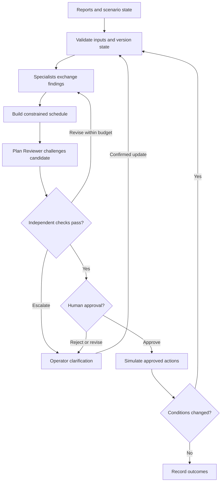

<p align="center">
  
</p>

# RE:L!NK

**Multi-agent decision support for telecom network restoration.**

Built by **HyperReAIlity · SLIIT** for the **Innodata AI Catalyst 2026 — University Track**.

[Proposal](docs/Proposal.docx) · [Project details](docs/PROJECT_DETAILS.md) · [Workflow](docs/Workflow.md) · [Architecture](#proposed-architecture) · [Development setup](#development-setup) · [Evaluation](#evaluation-plan)

> **Status: integrated synthetic recovery MVP.** The dashboard supports evidence inspection, operator clarification, validated planning, recorded approval, independent incident simulation and event-time continuation. Hosted single-/multi-agent workflows now share four decision stages, operational information, tools and budget caps; evidence-linked deferral requests can change the validated schedule. See [hosted protocol and verification](docs/HOSTED_FAIRNESS.md), [operator clarification](docs/OPERATOR_CONFIRMATION.md) and [benchmark scoring](docs/BENCHMARK_SCORING.md). Real OpenAI Luna execution is verified on the demo; development comparisons and their limitations are recorded in [Luna validation](docs/LUNA_LIVE_VALIDATION.md). No hosted performance advantage is claimed.

## Overview

RE:L!NK helps telecom operations teams plan service restoration when network faults, field resources and incident reports interact. It combines evidence interpretation, dependency analysis, constrained scheduling and human review to recommend which actions can restore useful connectivity.

The MVP models one fictional operator and executes approved actions in a simulator. Its working name during early planning was SIGNAL FIRST.

## The problem

A site can have power but remain disconnected because its upstream backhaul is unavailable. A qualified repair crew may be unable to reach a fault, or a limited generator may be allocated where it cannot yet restore service.

RE:L!NK addresses four operational questions:

- Which dependencies must be resolved before a repair has value?
- How should limited crews, generators and accessible routes be allocated?
- Which services should be prioritized under approved operating policies?
- How should a reviewed plan change when new evidence arrives?

The research findings, local and global context, and supporting references are in the [submitted proposal](docs/Proposal.docx).

## Intended users and business value

Primary users are network operations managers, incident coordinators and maintenance planners. Initial prospective customers are mobile network operators, followed by tower-infrastructure providers and managed network services.

| Value pillar | Planned operational benefit | Pilot measurement |
| --- | --- | --- |
| Operational efficiency | Reduce ineffective assignments, resource conflicts and repeated planning | Unproductive journeys, crew-hours, conflicts and planning time |
| Service continuity | Coordinate power, equipment and backhaul prerequisites | Weighted downtime, critical-service interruption and unmet services |
| Decision accountability | Link recommendations and revisions to evidence and approval | Trace completeness, review time and correct escalation |

The adoption path is practitioner discovery, authorized historical replay, a read-only pilot, then commercial deployment if agreed criteria are met. A potential offer combines an enterprise software licence, integration, support and simulation exercises connected to an organization-approved hosted LLM API. Financial value requires attributable improvements and operator-approved cost inputs.

## Planned MVP capabilities

- Load a network, resource inventory, service priorities and incident reports.
- Extract evidence-linked facts and expose missing or contradictory information.
- Investigate equipment, power and backhaul dependencies.
- Check crew skills, availability, route access and generator autonomy.
- Schedule equipment repairs, link repairs and generator deployments.
- Independently validate timing, dependencies and resource allocation.
- Display supporting evidence, unmet needs and agent exchanges.
- Require human approval before simulation.
- Invalidate approval and replan after material changes.
- Compare the workflow against conventional, single-agent and human baselines.

## Proposed architecture

| Agent | Responsibility | Output used by other components |
| --- | --- | --- |
| Network Investigator | Interpret reports and inspect network dependencies | Faults, prerequisites, evidence links and clarification questions |
| Field Resource Planner | Check skills, availability, access and power resources | Resource constraints, feasible actions and conflict warnings |
| Service Priority Assessor | Apply human-approved weights to service associations | Service priorities and trade-off explanations |
| Plan Reviewer | Challenge evidence and candidate plans | Revision requests, unresolved concerns and escalations |

A deterministic Python coordinator routes messages, versions shared state and enforces budgets. NetworkX supports dependency and path checks; CP-SAT builds schedules; separate software validates encoded feasibility. The coordinator and these tools are not additional AI agents.



Typed messages carry sender, recipient, incident ID, state version, finding, evidence IDs and requested action. Critical contradictions require authoritative confirmation or operator clarification. Revision loops stop or escalate when evidence or budgets are exhausted.

See [Workflow.md](docs/Workflow.md) for the detailed process, message example, decision rules and failure handling.

## Illustrative collaboration

A draft allocates a generator to Site A. The Investigator finds A's backhaul is down; the Resource Planner finds the fibre-skilled crew cannot reach it because the access road is closed. The Priority Assessor identifies reachable Site B where backup power can restore a critical service. The Reviewer challenges the allocation to A, and the coordinator requests confirmation and revises the schedule while recording A's unmet repair.

This synthetic example illustrates how findings change the shared plan. Actual timings and outcomes will come from the simulator.

## Scope and data

| Item | MVP decision |
| --- | --- |
| Network | One fictional operator, 15–20 sites, explicit dependencies |
| Resources | Two repair crews and limited generators |
| Simulation horizon | 12 hours |
| Supported actions | Equipment repair, link repair and generator deployment |
| Restoration condition | Working equipment, adequate power and a valid path to the core |
| Initial synthetic parameters | Repairs: 30–120 minutes; travel: 5–60 minutes; generator autonomy: 2–6 hours |
| Geographic context | Optional OpenStreetMap roads/facilities, with attribution |
| Optional cell context | OpenCellID, subject to access and suitability checks |

Network topology, resources, incidents and durations will be generated as reproducible synthetic scenarios. Service objects prevent overlapping-site double counts. Publish seeds, parameter assumptions, licences, provenance and transformations with the adopted data.

Live network control, autonomous dispatch, detailed radio propagation, national deployment and generator fuel replenishment are outside the MVP scope. Public cell observations are not an operator's topology or a complete physical-site inventory. Simulation findings require practitioner and operator validation before operational use.

## Technology and model decisions

| Layer | Planned choice |
| --- | --- |
| Application | Python 3.11+ and Streamlit |
| Agent orchestration | Explicit Python coordinator, typed messages and versioned shared state |
| Initial LLM provider | OpenAI hosted API through its Python SDK and a provider adapter |
| Model selection | Test other hosted models on development cases; freeze the selected model/configuration before held-out evaluation |
| Graph analysis | NetworkX |
| Scheduling | Google OR-Tools CP-SAT |
| Validation | Pydantic schemas and an independent feasibility checker |
| Storage and traces | SQLite, JSON/CSV and JSONL |
| Verification | pytest and reproducible scenario fixtures |

Agents use separate prompts and contexts, initially running sequentially. The primary single-/multi-agent comparison uses the same provider and exact model across all roles. Alternative models or per-role configurations are separate experiments, not silent substitutions. Local LLM execution is outside the current plan.

The exact model ID/version, supported settings, SDK and dependency versions will be recorded in [PROJECT_DETAILS.md](docs/PROJECT_DETAILS.md) and the benchmark manifest. API cost, request latency, tokens, retries and rate limits will be measured; no cost-free inference claim is made.

## Repository layout and current status

The repository root corresponds to the `university-project/` root in the competition guidelines.

| Path | Purpose | Status |
| --- | --- | --- |
| [docs/Proposal.docx](docs/Proposal.docx) | Submitted competition proposal | Uploaded on 20 November 2026 |
| [docs/Workflow.md](docs/Workflow.md) | Process, agent communication and implementation sequence | Current agent workflow, approval and continuation documented |
| [docs/PROJECT_DETAILS.md](docs/PROJECT_DETAILS.md) | Objectives, technical design, evaluation and disclosures | Current implementation, models and disclosures documented |
| [project/main.py](project/main.py) | Required application entry point | Integrated dashboard, live hosted planning, approval and independent incident simulation |
| [project/requirements.txt](project/requirements.txt) | Tested Python dependencies | Environment dependency versions recorded |
| `data/scenarios/` | Scenario fixtures and provenance | Placeholder |
| `tests/` | Verification code and fixtures | 508 automated tests; data, simulation, core, evaluation and UI checks |
| `results/` | Benchmark outputs and traces | Development aggregate reports published; raw local traces ignored by Git |
| `project-demo.mp4` | Actual-execution demonstration video | Pending |

## Development setup

Prepare a checkout and Python environment:

```bash
git clone https://github.com/inthiiii/hyperreaility-sliit.git
cd hyperreaility-sliit
python3 -m venv .venv
source .venv/bin/activate
```

Launch the dashboard foundation from the repository root:

```bash
python -m pip install -r project/requirements.txt
python -m streamlit run project/main.py
```

The dashboard defaults to DEMO-005 from six clearly labelled development fixtures until approved processed inputs are available. Run `python -m pytest -q` to verify the current core and UI checks. See [Push 1 setup and limits](docs/DASHBOARD_PUSH1.md); update model configuration and final sample-scenario instructions before submission. Configure the API key as a backend environment variable; never put credentials in the README, source, committed environment files or browser code. Other providers will use their own documented configuration through the adapter.

## Evaluation plan

Compare a priority heuristic, conventional CP-SAT, a tool-assisted single agent, RE:L!NK and human participants. Remove the Reviewer and disable inter-agent feedback separately to test their contribution.

| Evaluation decision | Plan |
| --- | --- |
| Cases | 10 development and 20 held-out scenarios; two held-out cases per predefined category |
| AI repetitions | Three runs per scenario/configuration; scenario median used for paired differences |
| Fair comparison | Same provider, exact model/version, supported generation/reasoning settings, tools, evidence and context cap within each pair |
| Aggregate automated-run caps | 12 model calls, 24,000 input tokens, 4,800 output tokens and 180 seconds; include retries and reported reasoning usage where applicable |
| Scheduler cap | Five seconds per attempt |
| Human comparison | Target four consenting participants on six shared small cases; manual schedule entry, no AI/automatic optimization, up to ten minutes per case |
| Reporting | Actual usage/cost, paired differences, failures, escalation and exploratory scenario-level bootstrap intervals |

Cases include equipment/power faults, coupled backhaul failures, skill shortages, road closures, conflicting or stale reports, missing critical evidence, generator exhaustion and mid-incident resource loss.

The primary metric is weighted service downtime over 12 hours, alongside unweighted service-hours and unmet services. Also measure critical-service interruption, feasibility, evidence precision/recall/F1, planning and replanning time, API cost, reassignments and geographic outcomes. Separate automated planning, human approval and simulated restoration time.

Proposed targets are at least **10% median paired downtime reduction** versus the single agent on positive-baseline cases, no higher run-failure rate, **zero encoded violations in accepted plans**, **evidence F1 ≥0.90** and automated runs within **180 seconds**. Report zero-baseline cases, all-case absolute differences and unmet targets. No measured benchmark results are available yet.

The full protocol and limitations are in [PROJECT_DETAILS.md](docs/PROJECT_DETAILS.md).

## Human oversight, security and reliability

- Human approval authorizes simulation only and is bound to the current plan/state version.
- Material changes invalidate approval and trigger reviewed replanning.
- Use at most three revision rounds and one schema-repair retry per model response; all retries share the global budgets.
- Use bounded backoff for transient API failures and rate limits. Escalate on unresolved critical facts, exhausted budgets, network loss or quota exhaustion.
- Treat incident reports as untrusted data; restrict tools and controlled state writes.
- Send only synthetic or explicitly authorized, appropriately redacted incident data to external APIs. Exclude confidential organizer materials and review provider data-handling terms.
- Commit only synthetic/redacted traces; never commit credentials or sensitive data.

## Delivery milestones

| Milestone | Target |
| --- | --- |
| Proposal | Uploaded 20 November 2026 |
| Development and integration | 20–25 November 2026 |
| Evaluation and evidence | 26 November 2026 |
| Documentation, video and clean-install check | 27 November 2026 |
| Internal MVP and complete project plan upload | **28 November 2026, 6:00 PM** |
| Official MVP and complete project plan deadline | **29 November 2026, 11:59 PM** |
| Final-day feature development for shortlisted teams | 7 December 2026 |

All times are Sri Lanka time. The internal target preserves contingency time. The demonstration video will show actual execution and meet the MP4/H.264/AAC, 5–10 minute, minimum 720p and maximum 100 MB requirements.

## Team HyperReAIlity

| Member | Proposed implementation ownership |
| --- | --- |
| Ihthisham Irshad — Team Leader | Architecture, scheduling, agent coordination and integration |
| Zahra Hassan | Data preprocessing, loader, independent simulator and metrics |
| Eyaas Ajmal | Interface, workflow and approval |
| Kiruthika Vijayakumar | Manual QA, defect reports and documentation support |

**University:** Sri Lanka Institute of Information Technology (SLIIT)  
**Domain:** Telecommunications  
**Competition:** Innodata AI Catalyst 2026 — University Track

## Collaboration and disclosures

Use focused implementation branches and pull requests, integrate daily through shared schemas and fixtures, and keep documentation aligned with implemented behavior. Preserve organizer access throughout the competition.

Declare every AI model, service, coding assistant, reused component and applicable licence in [PROJECT_DETAILS.md](docs/PROJECT_DETAILS.md). Disclose simulated, mocked and incomplete components; reported outputs must come from the submitted system. Update the initial disclosure register as team members use additional tools or adopt dependencies.

## References

- [Submitted proposal and research bibliography](docs/Proposal.docx)
- [OpenAI API reference](https://developers.openai.com/api/reference/overview)
- [OpenAI API pricing](https://developers.openai.com/api/docs/pricing)
- [OpenAI data controls](https://developers.openai.com/api/docs/guides/your-data)
- [ITU Disaster Connectivity Map](https://www.itu.int/en/ITU-D/Emergency-Telecommunications/Pages/Disaster-Connectivity-Map.aspx)
- [Google OR-Tools](https://developers.google.com/optimization)
- [OpenStreetMap copyright and data licence](https://www.openstreetmap.org/copyright)
- [OpenCellID data-access documentation](https://docs.opencellid.org/docs/downloads/overview)

Competition requirements are governed by the organizer-provided overview and university submission guidelines. References do not imply endorsement of RE:L!NK.

## Licence

The team has not yet selected a project licence. Third-party software, models and datasets remain subject to their respective licences. Do not assume this repository grants open-source reuse rights without an explicit licence.


### Core pre-merge checkpoint

The core now includes atomic local run records, a framework-independent `CoreSession` approval boundary, hosted-model preflight, and paired benchmark infrastructure. Current verification: 69 automated tests pass; no live model or independent restoration evaluation has been performed. See [pre-merge instructions](docs/PREMERGE_CHECKPOINT.md) for the stopping point and teammate integration contracts.


### Dashboard Push 1

The operator workspace foundation is available: five navigation views, safe scenario selection, overview, configuration checks and per-session state. Push 1 verification: **83 tests passed**, including 14 UI checks. Browsing makes no model requests. Planning and simulation controls are intentionally disabled until their integration pushes. See [dashboard handoff](docs/handoffs/eyaas.md).


### Dashboard Push 2

The Incident page now provides a synthetic dependency schematic, optional access-road layer, site observations and dependency inspection, searchable reports with provenance, crew/generator inventory, permitted action options and policy-weighted service associations. Snapshot observations remain separate from report text; no service restoration is inferred by browsing. Verification: **96 tests pass**, including 27 UI checks. See [Push 2 behavior and limits](docs/DASHBOARD_PUSH2.md).


### Dashboard Push 3

Planning now connects to the real core with explicit offline/hosted modes, CP-SAT/heuristic selection, actual schedules and travel/work timelines, evidence, agent messages, independent validation and run metadata. Per-session request guards prevent duplicate inference; retries and replacing a run clear old approval/results. Offline is the default. **117 tests pass**, including 48 UI/service checks; hosted tests use injected clients, not paid requests. See [Push 3 setup, verification and limits](docs/DASHBOARD_PUSH3.md).


### Dashboard Push 4

Operator approval/rejection now records exact run/plan/state bindings, notes and local audit history. Stale clicks, changed inputs, invalid/escalated plans and duplicate decisions are blocked; rejection revokes approval. A typed, approval-gated simulation boundary is ready, but the app attaches no mock simulator: simulation remains disabled until Zahra's independent evaluator is connected. **146 tests pass**, including 77 UI/service checks. See [Push 4 setup and simulator contract](docs/DASHBOARD_PUSH4.md).


### Dashboard Push 5 and independent merge

Read-only local run/decision/attempt history, safe exports and evaluator-output tables/charts are available. Missing results remain pending, null metrics remain unavailable, and opening history never restores authorization or starts inference. **161 tests pass**, including 92 UI/service checks. The dashboard workstream can be reviewed and merged independently; the real evaluator, actual outcome verification and full-system evaluation remain pending. See [Push 5](docs/DASHBOARD_PUSH5.md) and the [merge checklist](docs/DASHBOARD_MERGE_CHECKLIST.md).

### Independent simulation and incident continuation

The dashboard connects the real evaluator after explicit operator approval.
DEMO-005 demonstrates static recovery; DEV-010 pauses at crew loss, accepts a
visible update, generates a revised plan and requires fresh approval before
continuing the same incident. Results show measured service intervals, metric
units and action outcomes; prefix measurements never masquerade as full-horizon
results. No real equipment is dispatched.

See [Zahra's handoff](docs/handoffs/zahra.md),
[the acceptance matrix](docs/ZAHRA_ACCEPTANCE.md), and
[the rehearsal guide](docs/DEMO_AND_FAILURE_FLOWS.md).
The data release is frozen as a candidate snapshot. Independent human review and
hosted-model benchmarking remain separate required validation work.

## Matched hosted execution checkpoint

Single-agent and multi-agent workflows use the same four stages and tools. Original evidence, approved weights, independent validation and fresh human approval remain required. The benchmark freezes configuration, records actual usage/failures and emits a paired comparison with exclusions and coverage.

For bounded live verification, select an exact OpenAI model ID and run:

```sh
python -m project.evaluation.hosted_check --model gpt-6-luna --reasoning-effort none --api-mode responses --env-file .env --output results/local_benchmarks/hosted-check-01 --allow-live
```

This explicitly authorizes two development attempts (single and multi), each capped at 12 calls, 24,000 input tokens, 4,800 output tokens and 180 seconds. API charges are possible and are not estimated. Use a new output directory for each run. See [the protocol](docs/HOSTED_FAIRNESS.md) and [live validation](docs/LUNA_LIVE_VALIDATION.md) for assumptions and actual results.

### Selected Luna configuration

Keep the existing API key in `.env` and use these settings:

```dotenv
LLM_PROVIDER=openai
LLM_MODEL=gpt-6-luna
LLM_REASONING_EFFORT=none
LLM_API=responses
```

Restart Streamlit after changing settings. Responses input-token counts are checked before generation; count requests are audited separately from the 12 model-generation limit. Their latency counts toward the same run deadline. Chat Completions remains available with `LLM_API=chat_completions`. SOCKS environments additionally need `python -m pip install -r project/requirements-proxy.txt`; direct connections do not require that file.


### Priority 3–4 completion update — 25 November

The selected Luna workflow now uses strict structured responses, lossless compact
operational context, bounded reviewer clarification and visible-state service
forecasting. New operational holds always require a newly validated candidate and
fresh review; operator approval remains separate. Full regression: **458 passed**.
See [the completion update](docs/PRIORITY_3_4_COMPLETION.md) for current live
results, evidence and limits. Earlier benchmark cohorts retain their original
protocol labels and must not be pooled. Priority 5–7 remain separate milestones.


### Priority 5 — evaluation review preparation

A twenty-case evaluator-only review pack and hash-bound human-review gate are
available in [the Priority 5 instructions](docs/PRIORITY_5_REVIEW.md). Current
findings: all 20 topology descriptors occur in development, and all 34 report
texts overlap development. The worksheet remains **0/20 approved**. Candidate
evaluation runs now require a completed matching human-attestation release;
development/demo runs retain their existing entry path. Software checks cannot
certify reviewer independence or held-out validity. Steps 6–7 remain pending.


### Priority 5 — revised and AI-reviewed freeze

The requested revision and AI review are complete in
[evaluation v2](releases/evaluation-v2-20261125/README.md): 20 new cases,
20 distinct topology descriptors, no exact development report-text overlap,
20 filled AI review rows and an immutable checked release. The same coding
assistant authored/reviewed them; independent human review is still unperformed.
See [completion evidence](docs/PRIORITY_5_AI_COMPLETION.md). Full regression:
**508 passed**. The default human gate remains; AI engineering evaluation needs
explicit opt-in and carries its provenance in the manifest. Steps 6–7 are pending.


### Priority 6 — application QA checkpoint (25 November)

The browser walkthrough and regression checks are recorded in
[PRIORITY_6_QA.md](docs/PRIORITY_6_QA.md). Static and dynamic recovery, conflict/missing
evidence, rejection/retry, clarification, scenario changes and read-only history
were exercised. Two UI defects were fixed: stale review notes and valid hosted
metadata being skipped by History. **509 tests passed**. One hosted smoke
escalated after three calls; approval stayed blocked, but hosted happy-path
readiness remains open. Codex performed the walkthrough in Ihthisham's session;
Kiruthika and Eyaas receive requested co-author credit, separate from tester
identity. Priority 7 remains pending.
