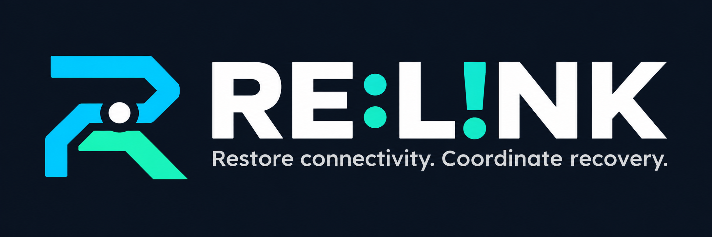
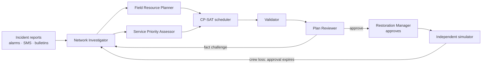

<p align="center">
  
</p>

# RE:L!NK

**Multi-agent decision support for telecom network restoration.**

Built by **HyperReAIlity · SLIIT** for the **Innodata AI Catalyst 2026 — University Track** (domain: Telecommunications).

[Proposal](docs/Proposal.docx) · [Project plan](docs/PROJECT_PLAN.md) · [Project details](docs/PROJECT_DETAILS.md) · [Workflow](docs/Workflow.md) · [Quick start](#quick-start) · [Evaluation](#evaluation)

> **Status (25 Nov 2026):** end-to-end synthetic MVP. Sign-in with roles → four AI specialists read messy incident reports → CP-SAT schedule → independent validation → reviewer challenge loop → hash-bound human approval → independent simulation with mid-incident replanning. A real single-agent baseline and a human-baseline scorer are implemented. The frozen held-out benchmark is complete (results below). The human sessions are pending.

## The problem

After a cyclone or flood, operators must decide what to restore first with too few crews, generators and open roads, from reports that conflict. A site carries traffic only if its **equipment works, it has power and its backhaul path to the core is up**, so a generator sent to a site with a cut link restores nothing. RE:L!NK turns fragmented reports into an evidence-linked, feasible plan that a human approves.

## How it works



| AI agent | Job |
|---|---|
| **Network Investigator** | Resolves town names, site codes and link endpoints in reports to asset IDs; flags complaints, rumours and prompt-injection attempts |
| **Field Resource Planner** | Checks crews, skills, roads and the generator; puts unsafe actions on hold; asks the operator about blocking unknowns |
| **Service Priority Assessor** | Applies approved service weights; proposes (never applies) priority changes for the manager |
| **Plan Reviewer** | Independently re-checks each fact against the raw report and challenges errors back to the Investigator |

Software, not agents: the coordinator (routing, state versions, budgets), evidence resolver, CP-SAT scheduler, validator and simulator. Details: [Workflow.md](docs/Workflow.md).

## Quick start

Requires Python 3.11.

```bash
git clone https://github.com/inthiiii/hyperreaility-sliit.git
cd hyperreaility-sliit
python3 -m venv .venv && source .venv/bin/activate
python -m pip install -r project/requirements.txt
cp .env.example .env        # then fill in the values below
```

In `.env`:

| Variable | Value |
|---|---|
| `OPENAI_API_KEY` | Your key (needed only for hosted single/multi-agent planning) |
| `LLM_PROVIDER`, `LLM_MODEL`, `LLM_API`, `LLM_REASONING_EFFORT` | `openai`, `gpt-6-luna`, `responses`, `none` |
| `RELINK_DEMO_PASSWORD` | Any password of 10+ characters for the demo users |

Create the demo users (one per role) and start the app:

```bash
python -m project.auth.manage seed-demo
```

```bash
python -m streamlit run project/main.py
```

Sign in as `coordinator` to generate a plan and as `manager` to approve and simulate it (same password). Other demo users: `field`, `auditor`, `admin`.

Pages: **Overview**, **Incident** (reports, crews, roads), **Map** (sites in real towns, replay of the simulated restoration), **Planning** (crew Gantt, agent conversation, operator inbox, approval), **Field work** (crew jobs and field updates), **Results**, **History**, **Settings** (roles).

The **Offline template baseline** needs no API key, but it cannot read free-text reports: on evidence v3 cases it can only plan around unknowns. That limitation is deliberate and is the reason the AI agents exist.

Run the tests:

```bash
python -m pytest -q
```

## Roles

| Role | Can |
|---|---|
| NOC Coordinator | Prepare plans, record clarifications |
| Restoration Manager | Approve / reject, simulate, continue incidents, decide priority proposals |
| Field Supervisor | Submit field updates (which expire approval) |
| Auditor | Read-only |
| Administrator | Settings and users; no planning or approval |

Permissions are enforced in the service layer. Passwords are stored as salted PBKDF2 hashes in `.relink/` (git-ignored). This is demo-grade sign-in, not production SSO.

## Evaluation

| System | Description |
|---|---|
| `heuristic` / `optimizer` | Greedy and CP-SAT without AI |
| `single` | One agent, one context: analyses everything, then reviews itself |
| `multi` | Four specialists with scoped contexts and an independent reviewer |
| `no_reviewer`, `no_feedback` | Ablations |
| `matched_single`, `matched_multi` | v13 controls (same stages, role label only) |
| Human | Up to 4 participants × 6 cases, scored by the same simulator ([protocol](docs/human_baseline/README.md)) |

All hosted variants share the model, tools, evidence and caps (12 calls, 24k input / 4.8k output tokens, 180 s).

- **Data:** [`releases/evidence-v3-20261126`](releases/evidence-v3-20261126/README.md), 31 synthetic cases with realistic reports and distractors.
- **Metrics:** weighted downtime, critical downtime, fact F1, distractor claims, injection handling, escalations, tokens, latency and cost.

```bash
python -m project.evaluation.runner \
  --scenarios releases/evidence-v3-20261126/data/processed/agent_inputs/development/*.json \
  --data-root releases/evidence-v3-20261126/data \
  --variants heuristic optimizer single multi no_reviewer no_feedback --repeats 3 --allow-live \
  --output results/final/development
```

**Held-out results** ([full report](results/final/evaluation-v3-run1/README.md): 20 frozen EVAL2 cases × 6 variants × 3 repeats = 360 attempts, 0 failures):

- Agents reading the reports reduce weighted downtime against CP-SAT without AI. Multi-agent is better on 13 of 20 cases and never worse (mean −2,378 weighted minutes, 95 % CI −4,044 to −981). The single agent is better on 11 of 19.
- **Multi vs single: no significant difference** (2 better, 15 ties, 2 worse; CI includes zero). The proposal's 10 % target is not met, and no superiority is claimed.
- Most reliable and cheapest agent configuration: multi-agent **without** the Reviewer, 60/60 completed and about 35 % fewer tokens than full multi. The Reviewer did not improve outcomes on this set.
- Prompt injection was followed in 0 of 130 runs that contained it.
- Cost per incident (upper bound, team-supplied prices as of 25 Nov 2026): multi about USD 0.039, single 0.032, multi without Reviewer 0.025.

Development tuning is recorded in [v14-dev-tuning](results/development/v14-dev-tuning-20261125/README.md).

## Repository layout

```
project/
  main.py              # entry point (Streamlit app)
  requirements.txt     # pinned dependencies
  agents/              # agent registry, schemas, context encoders
  auth/                # roles, password store, user CLI
  core/                # orchestrator, legacy coordinator, resolver, CP-SAT, validator
  data/                # allowlisted loaders (inputs vs evaluator truth)
  evaluation/          # benchmark runner, extraction metrics, human-trial scorer
  llm/                 # hosted model adapter (budgets, retries, schema repair)
  simulation/          # independent incident simulator
  ui/                  # dashboard pages and services
releases/              # frozen datasets (v2, evidence v3)
results/               # development runs and traces
docs/                  # proposal, plan, workflow, details, protocols, development log
scripts/               # data builders and checks
tests/                 # 569 pytest tests
```

## Disclosure

AI coding assistants were used: ChatGPT/Codex (OpenAI) and Claude Code (Anthropic, Claude Opus 5.5). The runtime model is OpenAI `gpt-6-luna`. Data is synthetic; town coordinates are public, and district boundaries are from geoBoundaries (ODbL). Full register: [PROJECT_DETAILS.md §9](docs/PROJECT_DETAILS.md#9-ai-tools-services-and-third-party-components-disclosure).
