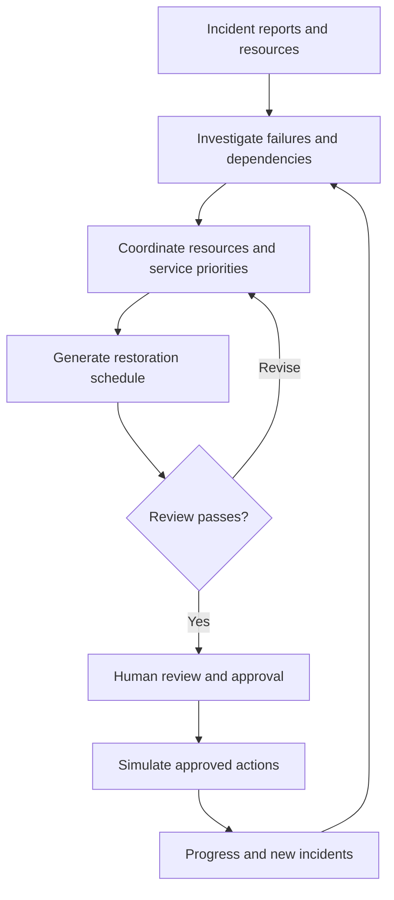

# RE:L!NK

### Restore connectivity. Coordinate recovery.

**Multi-agent decision support for telecom network restoration.**

Built by **HyperReAIlity · SLIIT** for the **Innodata AI Catalyst 2026 — University Track**.

[Repository](https://github.com/inthiiii/hyperreaility-sliit) · [Project overview](#overview) · [Architecture](#proposed-architecture) · [Development setup](#development-setup) · [Evaluation](#evaluation-plan)

> **Status: planning and initial development.** The capabilities and architecture below describe the intended MVP. They are not claims of completed implementation, operator integration, or measured performance. The application was previously discussed under the working name SIGNAL FIRST.

## Overview

RE:L!NK is a proposed decision support application that helps telecom operations teams plan service restoration during major outages. It brings together incident reports, network dependencies, field resources, and service priorities to recommend a feasible recovery plan for human review.

The MVP will use a small simulated network and documented scenarios. It will recommend actions; it will not control live telecommunications infrastructure or dispatch real crews.

## The problem

Restoration requires more than ranking failed towers. A site can have power but remain disconnected because its upstream backhaul is unavailable. A repair crew may lack the right equipment, a road may be blocked, or limited backup generators may be needed at several locations.

RE:L!NK will help answer:

- Which actions restore useful service first?
- Which dependencies must be resolved before a repair has value?
- How should limited crews, generators, and fuel be allocated?
- How should the plan change when new field information arrives?

## Intended users and business value

The initial users are telecom network operations managers, incident coordinators, and field maintenance planners.

| Operational need | Proposed value | Measurement |
| --- | --- | --- |
| Prioritize simultaneous outages | Restore important services earlier | Weighted service downtime and critical facility restoration time |
| Avoid ineffective dispatch | Account for dependencies and access | Unproductive trips and crew hours |
| Allocate scarce backup power | Coordinate generators and fuel | Resource feasibility and estimated consumption |
| Respond to changing conditions | Revise plans with an audit trail | Replanning time and unnecessary reassignment |

These are evaluation objectives. Real operator savings and commercial adoption require practitioner validation and a later pilot.

## Planned MVP capabilities

- Load network, resource, and incident scenarios.
- Investigate outages and backhaul dependencies.
- Interpret short field reports and identify missing or conflicting facts.
- Coordinate repair crews, backup power, and operator-defined service priorities.
- Generate a validated restoration schedule.
- Show structured agent exchanges and supporting evidence.
- Require human review and approval.
- Replan after a new outage, road closure, or resource change.
- Compare results with documented baseline methods.

## Proposed architecture

| Agent | Responsibility | Collaboration |
| --- | --- | --- |
| Network Investigator | Interpret incidents and inspect dependencies | Share prerequisites and unresolved facts |
| Field Resource Planner | Assess crews, equipment, travel, and power | Provide resource constraints and feasible actions |
| Service Priority Assessor | Apply operator-defined priorities | Assess effects on critical facilities and service demand |
| Plan Reviewer | Challenge assumptions and review plans | Request corrections or escalate unresolved uncertainty |

Agents will share structured findings and use one another's outputs. Graph algorithms and scheduling tools will calculate dependencies and validate resource constraints. Language models will support interpretation and coordination rather than serve as unchecked numerical schedulers.



Coordination will use bounded rounds, validated outputs, and explicit escalation when facts cannot be established. Detailed message schemas and workflow decisions will be documented in `docs/Workflow.md`.

## Illustrative scenario

A generator is initially considered for the largest failed tower. Investigation reveals that the tower also has a backhaul failure. The agents compare repairing that dependency with powering another site that serves a critical facility. A subsequent road closure triggers a revised plan.

This is a planned demonstration scenario, not a reported operational outcome.

## Scope and data

The target MVP covers one fictional operator, approximately 15–20 sites, explicit backhaul dependencies, two repair crews, limited backup power, and a small road network.

| Data | Planned approach |
| --- | --- |
| Roads and facility locations | Public geographic data where accessible, with attribution |
| Network topology and dependencies | Clearly labelled synthetic scenarios |
| Crews, generators, fuel, and repair durations | Documented simulation assumptions |
| Incident reports and updates | Authored scenarios with independently checked expected facts |
| Optional cell observations | Assess availability and suitability before adoption |

Public cell observations do not establish an operator's topology, outage status, or complete physical site inventory. Simulated service availability will not be presented as certified radio coverage.

Do not add confidential operator or organizer data without authorization. Keep provenance, access dates, licences, and synthetic assumptions with each adopted dataset. Dataset acquisition is still pending.

## Proposed technology choices

| Layer | Candidate approach |
| --- | --- |
| Application | Python with a local web dashboard |
| Network analysis | NetworkX |
| Scheduling | Google OR-Tools CP-SAT |
| Agent orchestration | Explicit Python coordination loop and shared structured state |
| Local inference | Ollama with a suitable locally tested model |
| Storage | SQLite and versioned JSON/CSV files |

These choices are provisional. Pin tested dependencies and record the actual model, licence, settings, and hardware in `docs/PROJECT_DETAILS.md` as implementation progresses. Local inference avoids paid API calls but still consumes hardware resources and electricity.

## Repository layout

The repository root represents the `university-project/` root illustrated in the competition guidelines. Required submission paths are:

| Path | Purpose |
| --- | --- |
| `project/main.py` | Application entry point |
| `project/requirements.txt` | Tested Python dependencies |
| `README.md` | Project overview, setup, and execution guide |
| `docs/Proposal.docx` | Competition proposal |
| `docs/Workflow.md` | Workflow, communication, and implementation process |
| `docs/PROJECT_DETAILS.md` | Features, technical details, dependencies, and AI-tool disclosures |
| `project-demo.mp4` | Demonstration video |

Optional supporting folders may include `data/`, `tests/`, and `results/`. The proposal and video must be real deliverables, not empty placeholder files.

## Development setup

Clone the repository:

```bash
git clone https://github.com/inthiiii/hyperreaility-sliit.git
cd hyperreaility-sliit
```

For the planned Python implementation, create an isolated environment:

```bash
python3 -m venv .venv
source .venv/bin/activate
```

**The runnable application and dependency list are not established by this README.** Once `project/requirements.txt` and `project/main.py` contain the implementation, the intended commands are:

```bash
python -m pip install -r project/requirements.txt
python project/main.py
```

Update this section with the tested Python version, model setup, exact launch command, dashboard address, and sample scenario before the MVP submission.

## Evaluation plan

Compare the same documented tasks across:

1. A simple priority-based heuristic.
2. A conventional optimizer using structured inputs.
3. A single AI agent with comparable tools and information.
4. The proposed multi-agent system.
5. Human participants, with expertise and test conditions disclosed.

Measure critical service restoration time, weighted service downtime, crew travel, resource and dependency violations, planning latency, unsupported assumptions, and compute use. Reserve unseen scenarios and repeat AI runs. Report clean structured cases separately from ambiguous or changing incident cases.

No benchmark results are available in this initial README. Targets must not be presented as achieved improvements.

## Delivery milestones

| Milestone | Target |
| --- | --- |
| Proposal | 20 November 2026 |
| Internal MVP submission | **28 November 2026** |
| Official MVP and complete project plan deadline | 29 November 2026 |
| Grand finale for shortlisted teams | 7 December 2026 |

The internal target preserves a contingency day. Confirm final submission procedures against organizer announcements.

## Team HyperReAIlity

| Member | Role |
| --- | --- |
| Ihthisham Irshad | Team Leader |
| Zahra Hassan | Team Member |
| Eyaas Ajmal | Team Member |
| Kiruthika Vijayakumar | Team Member |

**University:** Sri Lanka Institute of Information Technology (SLIIT)  
**Domain:** Telecommunications  
**Competition:** Innodata AI Catalyst 2026 — University Track

## Collaboration and disclosures

- Use focused branches and pull requests for implementation work.
- Keep documentation aligned with demonstrated capabilities.
- Never commit API keys, passwords, access tokens, or private environment files.
- Acknowledge reused code, frameworks, models, datasets, and applicable licences.
- Declare every AI model, service, and development assistant actually used in `docs/PROJECT_DETAILS.md`.
- Preserve organizer access throughout the competition.
- Disclose simulations, mocked components, and incomplete features.

## References

- [ITU Disaster Connectivity Map](https://www.itu.int/en/ITU-D/Emergency-Telecommunications/Pages/Disaster-Connectivity-Map.aspx)
- [Google OR-Tools](https://developers.google.com/optimization)
- [OpenStreetMap copyright and data licence](https://www.openstreetmap.org/copyright)
- [OpenCellID documentation](https://docs.opencellid.org/docs/introduction)

Competition requirements are governed by the organizer-provided overview and university submission guidelines. References do not imply endorsement of RE:L!NK.

## Licence

The team has not yet selected a project licence. Third-party software, models, and datasets remain subject to their respective licences. Do not assume this repository grants open-source reuse rights without an explicit licence.
