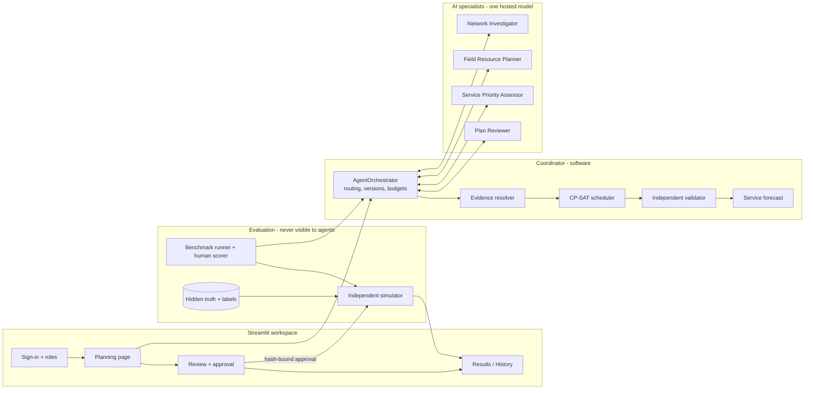

# RE:L!NK — Complete Project Plan

Innodata AI Catalyst 2026 · University Track · Team HyperReAIlity (SLIIT) · 25 November 2026

This plan covers the architecture, agent design, benchmarking and evaluation, milestones and risk analysis. Behaviour details are in [Workflow.md](Workflow.md) and technology and disclosures in [PROJECT_DETAILS.md](PROJECT_DETAILS.md).

## 1. Architecture

| Layer | Components | Key property |
|---|---|---|
| Access | `project/auth` | Five roles; permissions checked in services |
| Input | Allowlisted loader, Pydantic contracts | Agents only see processed inputs; truth is in a separate loader |
| Reasoning | Agent registry + orchestrator | Role-scoped views, typed messages, bounded revision |
| Decision tools | Resolver, CP-SAT, validator, forecast | Deterministic and testable; the model never computes schedules |
| Control | Approval records | Bound to plan hash and state hash; any change revokes them |
| Measurement | Simulator, runner, human scorer | Same scoring for AI and humans; failures kept |

## 2. Agent design

| Agent | Responsibility | Inputs | Outputs | Influence on the plan |
|---|---|---|---|---|
| Network Investigator | Turn noisy reports into claims about specific assets | Reports, site directory, topology | Facts, ignored reports | Decides which faults the scheduler can act on |
| Field Resource Planner | Feasibility and operational holds | Crews, roads, generators, catalogue, facts | Holds, questions | Removes unsafe or impossible actions |
| Service Priority Assessor | Policy application, critical-service context | Services, policy, reports | Proposals, trade-offs | Raises priority questions to the human (never edits weights) |
| Plan Reviewer | Independent verification | Raw reports, facts, plan, checks | Challenges, holds, decision | Forces re-extraction or re-planning |

**Communication:** typed messages through the coordinator. The Investigator shares facts with all three other roles, and Reviewer challenges are routed back to the Investigator.
**Conflict resolution:** authority rules decide facts. Equal-authority contradictions stay unknown until a human confirms. Agent agreement never verifies a fact.
**Human oversight:** a Restoration Manager approves every plan before simulation and decides priority proposals. A Coordinator or Field Supervisor can add confirmed evidence, which expires approval.

## 3. Benchmarking and evaluation plan

| Question | Comparison | Metric |
|---|---|---|
| Does specialisation help? | multi vs single (same model, tools, caps) | Paired weighted downtime; fact F1; distractor claims |
| Does the reviewer matter? | multi vs no_reviewer | F1 after review; invalid or unsafe assignments |
| Does feedback matter? | multi vs no_feedback | Escalations; downtime |
| Is AI needed at all? | heuristic, CP-SAT vs agents | Downtime; time to plan |
| How do humans do? | 4 participants × 6 cases | Downtime, plan validity, minutes per case |
| What does it cost? | all hosted variants | Calls, tokens, USD per incident, latency |
| Is it safe? | all | Injection followed or flagged; zero validator violations in approved plans |

**Protocol:**

- 10 development cases are used for tuning.
- 20 EVAL2 cases are frozen by hash before any run, with no tuning on them.
- Each hosted variant runs 3 times per case, interleaved by a seeded shuffle. The model, settings, prompts and commit are recorded in the run manifest.
- Analysis uses per-case medians, then paired differences and scenario-level bootstrap intervals.
- Escalations and failures are reported separately and never dropped silently.

**Success targets (from the proposal):**

- ≥ 10 % median paired downtime reduction against the single agent on cases with positive baseline downtime;
- no higher failure rate;
- zero violations in approved plans;
- fact F1 ≥ 0.90;
- runs within 180 s.

Unmet targets will be reported as such.

## 4. Milestones

| Date (2026) | Milestone | Owner | Status |
|---|---|---|---|
| 20 Nov | Proposal submitted | All | Done |
| 21–24 Nov | Core contracts, CP-SAT, validator, simulator, dashboard, approval, continuation | I, Z, E | Done |
| 25 Nov | v2 evaluation freeze, QA rehearsal, gap review | I, K | Done |
| **25 Nov (plan days 1–2)** | Evidence v3, v14 orchestrator, real single agent, sign-in and roles, human scorer; map, agent conversation, crew Gantt, operator inbox, field work; development tuning; EVAL2 configuration freeze | Z, I, E, K | Done |
| 26–27 Nov | Human sessions; full held-out benchmark (after API quota check); results analysis | K, E, I, Z | Planned |
| 28 Nov | Results analysis, Benchmark page, cost table, final docs, fresh-clone test; **internal freeze 18:00** | All | Planned |
| 29 Nov | Demo video, release tag, submission before 23:59 | All | Planned |
| 30 Nov – 6 Dec | Final-day feature drills, 10 slides, 15-minute demo rehearsal | All | Planned |
| 7 Dec | Grand finale: build the announced features | All | — |

## 5. Risk analysis

| Risk | Likelihood | Impact | Mitigation | Owner |
|---|---|---|---|---|
| Multi agent shows no advantage | Medium | High (benchmark marks) | Harder evidence v3; report honestly with ablations, cost and safety findings; no superiority claim without data | I, K |
| Hosted API outage, rate limit or quota | Medium | High | Bounded retries; budgets; template mode for offline demo; check quota before the benchmark | I |
| Excessive escalation | Medium | Medium | Partial plans and questions instead of escalation; tuning on development cases only | I |
| Over-tuning to evaluation cases | Low | High | EVAL2 frozen by hash; tuning restricted to development | Z |
| Human participants unavailable | Medium | Medium | Book 4 people for 26–27 Nov; report a smaller sample honestly | K |
| Synthetic-to-real gap | High | Medium | State limits; propose an authorised historical replay and read-only pilot | All |
| Prompt injection via reports | Medium | Medium | Untrusted-text rule; no model-controlled authority or weights; measured | I |
| Credential leakage | Low | High | `.env` and `.relink/` git-ignored; hashed passwords; no secrets in traces | E |
| Final-day features hard to add | Medium | High | Agent registry; feature drills before 7 Dec | All |
| Demo failure on stage | Low | High | Rehearsed script; recorded video as backup clearly labelled; offline template mode | E, K |

## 6. Final-day readiness

- A new agent is one `AgentSpec` entry.
- New action kinds touch the scheduler, validator and simulator together (drill planned).
- Likely requests: multiple generators or refuelling, temporary microwave/drone backhaul, a weather/hazard agent, scenario upload, plan export, multilingual reports.
