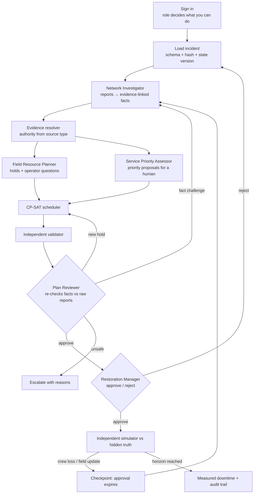

# RE:L!NK — Workflow

**Restore connectivity. Coordinate recovery.**

Team HyperReAIlity, SLIIT · Innodata AI Catalyst 2026, University Track · Version 1.0 (agent protocol `relink-agents-v14`) · Updated 25 November 2026

This file describes the process **as implemented**. Planned items are labelled as planned. The earlier proposal-stage version is archived at [development_log/Workflow_v0.4.md](development_log/Workflow_v0.4.md).

## 1. End-to-end flow



Every arrow between agents is a recorded message (`sender`, `recipient`, `state_version`, content). The coordinator, resolver, scheduler, validator and simulator are software, not AI agents.

## 2. Stages

| # | Stage | Who | What happens | Output |
|---|---|---|---|---|
| 1 | Sign in | Any user | Local sign-in; the role sets permissions (see §6) | Identity recorded on every decision |
| 2 | Load incident | Coordinator | Allowlisted loader validates the scenario; content hash and state version 1 | `ScenarioInput`, hash |
| 3 | Investigate | **Network Investigator** (AI) | Reads every report; resolves town names, site codes, landmarks and link endpoints to IDs; one fact per claim; flags complaints, rumours and instruction attempts | `Extraction` (facts, ignored reports) |
| 4 | Resolve evidence | Software | Drops malformed facts one by one; sets authority and timestamps from the cited report; equal-authority conflicts and contradictions become *unknown* | `VerifiedState` + unknowns |
| 5 | Check resources | **Field Resource Planner** (AI) | Crews, skills, roads, generators, catalogue vs faults; typed `defer_action` only with evidence; up to 4 operator questions | Holds, questions |
| 6 | Assess priorities | **Service Priority Assessor** (AI) | Applies approved weights; can only *propose* a change for the manager | Trade-offs, priority proposals |
| 7 | Schedule | CP-SAT (software) | Maximises weighted service-minutes on 5-minute slots; unknown assets are treated as unavailable | Candidate plan |
| 8 | Validate | Validator (software) | Recomputes skills, windows, overlaps, routes, travel, durations, generator limits and need | Valid / violations |
| 9 | Review | **Plan Reviewer** (AI) | Separate context: raw reports + extracted facts + plan, not the Investigator's reasoning. Approve, challenge a fact, add a hold, or escalate | Decision, challenges |
| 10 | Revise | Coordinator | Fact challenge → Investigator re-extracts → new state version → re-plan. New hold → re-plan. At most 3 rounds | New candidate |
| 11 | Approve | **Restoration Manager** (human) | Approves or rejects the exact plan + state (hash-bound) | Approval record |
| 12 | Simulate | Independent simulator | Executes against hidden truth; pauses at incident events | Measured service intervals |
| 13 | Continue | Manager | Accepts the checkpoint; approval expires; a fresh plan and approval are needed | New state version |

## 3. Single-agent baseline (same task, same tools, same caps)

One agent, one accumulating conversation:

1. **Analyse:** one response with facts, ignored reports, holds, questions and priority proposals (the jobs of steps 3, 5 and 6).
2. Steps 4, 7 and 8 run on the same software tools.
3. **Self-review:** the same agent reviews its own plan with its earlier analysis in context (it is re-sent only the new plan, validation and forecast).
4. A self-challenge triggers re-analysis in the same conversation; at most 3 rounds.

The controlled difference is **specialised, scoped contexts plus an independent reviewer** versus **one generalist context reviewing itself**. The v13 "matched pipeline" (same four stages, role label only) is kept as an extra control: `matched_single` / `matched_multi`.

## 4. Message and state contract

| Field | Meaning |
|---|---|
| `sender`, `recipient` | Agent role, `coordinator`, `deterministic_scheduler` or `audit` |
| `incident_id`, `state_version` | The exact state the message applies to |
| `finding` | Typed content: facts, holds, questions, proposals, challenges, schedules |

State versions increase on every applied hold, re-extraction, operator clarification and checkpoint. Approval stores the plan hash and state hash, so any change invalidates it. Run records are saved as JSON traces under `results/local_runs/` (dashboard) or `<output>/runs/` (benchmark).

## 5. Reliability rules

- **Whole-run caps:** 12 model calls, 24,000 input tokens, 4,800 output tokens and 180 s, including retries. Each CP-SAT attempt is capped at ≤ 5 s, with a greedy fallback recorded in the plan config.
- **Retries:** one schema-repair retry per response; one retry with backoff for HTTP 408/409/429/5xx or timeouts. Every retry is a budgeted, recorded call.
- **Escalation** (no plan offered for approval): API failure, exhausted budget, reviewer judges the plan unsafe, or no approval after 3 revision rounds.
- **No escalation for unknowns:** the plan covers what is certain, unknown assets stay unrepaired, and the operator receives targeted questions.
- **Constraints are never relaxed silently;** weights and authority are never model-controlled.

## 6. Roles and permissions

| Role | Prepare plan | Clarify facts | Approve / reject | Simulate / continue | History |
|---|:-:|:-:|:-:|:-:|:-:|
| NOC Coordinator | ✓ | ✓ | | | ✓ |
| Restoration Manager | | | ✓ | ✓ | ✓ |
| Field Supervisor | | ✓ | | | |
| Auditor | | | | | ✓ |
| Administrator | | | | | ✓ (+ settings, users) |

Checks run in the service layer. The approver can never be the person who generated the plan, because no role can do both.

## 7. Evaluation workflow

1. **Data:** `releases/evidence-v3-20261126` = 1 demo, 10 development and 20 EVAL2 cases with realistic reports and distractors ([README](../releases/evidence-v3-20261126/README.md)).
2. **Tune** prompts and settings on development cases only. Then freeze the code commit, model ID, settings, prompts and dataset hashes before any EVAL2 run:
   ```bash
   python -m project.evaluation.freeze create --data-root releases/evidence-v3-20261126/data --output releases/evidence-v3-20261126/FREEZE.json
   ```
   The runner's `--freeze` option re-verifies everything and stops on any drift.
3. **Run** `heuristic`, `optimizer`, `single`, `multi`, `no_reviewer`, `no_feedback` (plus `matched_*` controls), 3 repeats per case, interleaved:
   ```bash
   python -m project.evaluation.runner --scenarios releases/evidence-v3-20261126/data/processed/agent_inputs/development/*.json \
     --data-root releases/evidence-v3-20261126/data --variants heuristic optimizer single multi no_reviewer no_feedback \
     --repeats 3 --allow-live --output results/final/development
   ```
4. **Score** with the same simulator. Extraction F1, distractor claims and injection handling are scored evaluator-side from hidden labels.
5. **Human baseline:** [human_baseline/README.md](human_baseline/README.md), 6 cases × up to 4 participants, scored by `project.evaluation.human_trial` with the same validator and simulator.
6. **Report** paired case medians, failures and escalations, cost and time. No superiority claim without evidence.

Status on 25 November 2026: steps 1–3 are implemented. Development tuning is recorded in [v14-dev-tuning](../results/development/v14-dev-tuning-20261125/README.md) and the EVAL2 configuration is frozen. The EVAL2 run and the human sessions are pending.
