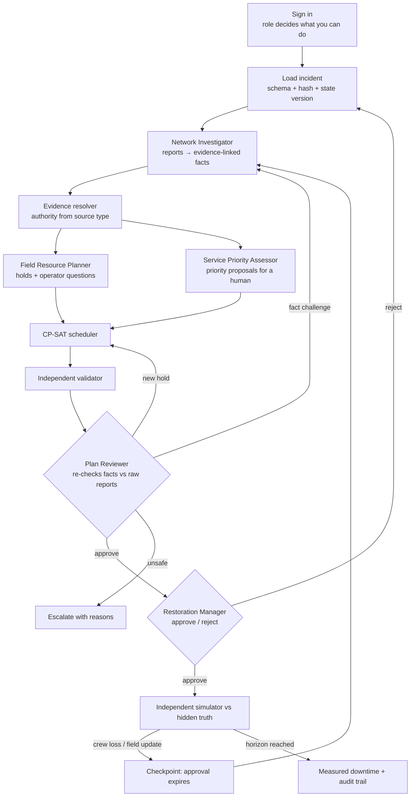

# RE:L!NK — Workflow

**Restore connectivity. Coordinate recovery.**

Team HyperReAIlity, SLIIT · Innodata AI Catalyst 2026, University Track · Version 1.1 (agent protocol `relink-agents-v14`) · Updated 27 November 2026 (submission version)

This file describes the process **as implemented**. Planned items are labelled as planned. The earlier proposal-stage version is archived at [development_log/Workflow_v0.4.md](development_log/Workflow_v0.4.md).

## 1. End-to-end flow



Every arrow between agents is a recorded message (`sender`, `recipient`, `state_version`, content). The coordinator, resolver, scheduler, validator and simulator are software, not AI agents.

## 2. Stages

| # | Stage | Who | What happens | Output |
|---|---|---|---|---|
| 1 | Sign in | Any user | Local sign-in; the role sets permissions (see §6) | Identity recorded on every decision |
| 2 | Load incident | Coordinator | Allowlisted loader validates the scenario; content hash and state version 1 | `ScenarioInput`, hash |
| 3 | Investigate | **Network Investigator** (AI) | Reads every report; resolves town names, site codes, landmarks and link endpoints to IDs; one fact per claim; flags complaints, rumours and instruction attempts | `Extraction` (facts, ignored reports) |
| 4 | Resolve evidence | Software | Drops malformed facts one by one; sets authority and timestamps from the cited report; equal-authority conflicts and contradictions become *unknown* | `VerifiedState` + unknowns |
| 5 | Check resources | **Field Resource Planner** (AI) | Crews, skills, roads, generators, catalogue vs faults; typed `defer_action` only with evidence; up to 4 operator questions | Holds, questions |
| 6 | Assess priorities | **Service Priority Assessor** (AI) | Applies approved weights; can only *propose* a change for the manager | Trade-offs, priority proposals |
| 7 | Schedule | CP-SAT (software) | Maximises weighted service-minutes on 5-minute slots; unknown assets are treated as unavailable | Candidate plan |
| 8 | Validate | Validator (software) | Recomputes skills, windows, overlaps, routes, travel, durations, generator limits and need | Valid / violations |
| 9 | Review | **Plan Reviewer** (AI) | Separate context: raw reports + extracted facts + plan, not the Investigator's reasoning. Approve, challenge a fact, add a hold, or escalate | Decision, challenges |
| 10 | Revise | Coordinator | Fact challenge → Investigator re-extracts → new state version → re-plan. New hold → re-plan. At most 3 rounds | New candidate |
| 11 | Approve | **Restoration Manager** (human) | Approves or rejects the exact plan + state (hash-bound) | Approval record |
| 12 | Simulate | Independent simulator | Executes against hidden truth; pauses at incident events | Measured service intervals |
| 13 | Continue | Manager | Accepts the checkpoint; approval expires; a fresh plan and approval are needed | New state version |

## 3. Single-agent baseline (same task, same tools, same caps)

One agent, one accumulating conversation:

1. **Analyse:** one response with facts, ignored reports, holds, questions and priority proposals (the jobs of steps 3, 5 and 6).
2. Steps 4, 7 and 8 run on the same software tools.
3. **Self-review:** the same agent reviews its own plan with its earlier analysis in context (it is re-sent only the new plan, validation and forecast).
4. A self-challenge triggers re-analysis in the same conversation; at most 3 rounds.

The controlled difference is **specialised, scoped contexts plus an independent reviewer** versus **one generalist context reviewing itself**. The v13 "matched pipeline" (same four stages, role label only) is kept as an extra control: `matched_single` / `matched_multi`.

## 4. Message and state contract

| Field | Meaning |
|---|---|
| `sender`, `recipient` | Agent role, `coordinator`, `deterministic_scheduler` or `audit` |
| `incident_id`, `state_version` | The exact state the message applies to |
| `finding` | Typed content: facts, holds, questions, proposals, challenges, schedules |

State versions increase on every applied hold, re-extraction, operator clarification and checkpoint. Approval stores the plan hash and state hash, so any change invalidates it. Run records are saved as JSON traces under `results/local_runs/` (dashboard) or `<output>/runs/` (benchmark).

## 5. Reliability rules

- **Whole-run caps:** 12 model calls, 24,000 input tokens, 4,800 output tokens and 180 s, including retries. Each CP-SAT attempt is capped at ≤ 5 s, with a greedy fallback recorded in the plan config.
- **Retries:** one schema-repair retry per response; one retry with backoff for HTTP 408/409/429/5xx or timeouts. Every retry is a budgeted, recorded call.
- **Escalation** (no plan offered for approval): API failure, exhausted budget, reviewer judges the plan unsafe, or no approval after 3 revision rounds.
- **No escalation for unknowns:** the plan covers what is certain, unknown assets stay unrepaired, and the operator receives targeted questions.
- **Constraints are never relaxed silently;** weights and authority are never model-controlled.

## 6. Roles and permissions

| Role | Prepare plan | Answer questions / field updates | Approve / reject | Simulate / continue | History + exports | Add incident (JSON) | Settings + users |
|---|:-:|:-:|:-:|:-:|:-:|:-:|:-:|
| NOC Coordinator | ✓ | ✓ (and replan) | | | ✓ | ✓ | |
| Restoration Manager | | | ✓ (+ priority proposals) | ✓ | ✓ | | |
| Field Supervisor | | ✓ (field updates) | | | | | |
| Auditor | | | | | ✓ (read-only) | | |
| Administrator | | | | | history only | ✓ | ✓ |

Checks run in the service layer (`project/auth/roles.py`), not only in the interface. The approver can never be the person who generated the plan, because no role can do both. Every decision records the username and role.

## 6a. Operator workflow in the dashboard

How the stages above appear to the people using RE:L!NK. The sidebar shows a red badge and a **For you now** list for whatever the signed-in role should do next.

| Step | Role | Page | What happens | Notification it raises |
|---|---|---|---|---|
| 1 | Any | Overview, Incident, Map ① | Inspect the incident: sites, reports with provenance, crews, roads, services; map of reported damage | — |
| 2 | Coordinator | Planning ① Generate | Choose Offline template (free) or Hosted single / multi-agent; a **live diagram** shows each agent working and every message | — |
| 3 | Coordinator | Planning ② Inspect plan | Schedule and crew Gantt, evidence, agent conversation with **replay**, **Operator inbox** | "N agent questions to answer" |
| 4 | Coordinator | Operator inbox | Answer each question (value, source, "I verified"); the answer becomes signed evidence and the plan is **regenerated automatically** | "Plan sent: waiting for a Restoration Manager" |
| 5 | Manager | Planning ③ Review & approve | Approve or reject the exact plan (hash-bound); decide any priority proposals | "A plan is waiting for your approval" |
| 6 | Manager | Planning ④ Simulate | Independent simulator executes the approved plan; pauses at incident events | "Approved plan ready to simulate" |
| 7 | Manager | Results | Measured downtime and services, **compare with the no-AI baseline**, download the **plan summary PDF** | "Incident event: accept the update and replan" (if an event occurs) |
| 8 | Field Supervisor | Field work | Crew job lists; a **field update** records new evidence, expires approval and sends the plan back to step 2 | "N jobs assigned in the approved plan" |
| 9 | Manager or Coordinator | Map ②–④ | See what the agents established, crew routes, and a timed **restoration replay** | — |
| 10 | Manager or Coordinator | What-if | Remove a crew or close a road; check whether the current plan still works; CP-SAT replans in a sandbox (no model calls, real plan untouched) | — |
| 11 | Coordinator or Admin | Sidebar: Add an incident | Upload a new incident JSON; checked by the same loader and state builder; can be planned and approved, not simulated | — |
| 12 | Auditor | History, Benchmark | Read-only trail of runs, decisions, simulations and clarifications; exports and plan PDFs; held-out benchmark results | — |

## 7. Evaluation workflow

1. **Data:** `releases/evidence-v3-20261126` = 1 demo, 10 development and 20 EVAL2 cases with realistic reports and distractors ([README](../releases/evidence-v3-20261126/README.md)).
2. **Tune** prompts and settings on development cases only. Then freeze the code commit, model ID, settings, prompts and dataset hashes before any EVAL2 run:
   ```bash
   python -m project.evaluation.freeze create --data-root releases/evidence-v3-20261126/data --output releases/evidence-v3-20261126/FREEZE.json
   ```
   The runner's `--freeze` option re-verifies everything and stops on any drift.
3. **Run** `heuristic`, `optimizer`, `single`, `multi`, `no_reviewer`, `no_feedback` (plus `matched_*` controls), 3 repeats per case, interleaved:
   ```bash
   python -m project.evaluation.runner --scenarios releases/evidence-v3-20261126/data/processed/agent_inputs/development/*.json \
     --data-root releases/evidence-v3-20261126/data --variants heuristic optimizer single multi no_reviewer no_feedback \
     --repeats 3 --allow-live --output results/final/development
   ```
4. **Score** with the same simulator. Extraction F1, distractor claims and injection handling are scored evaluator-side from hidden labels.
5. **Human baseline:** [human_baseline/README.md](human_baseline/README.md), 6 cases × up to 4 participants, scored by `project.evaluation.human_trial` with the same validator and simulator.
6. **Report** paired case medians, failures and escalations, cost and time. No superiority claim without evidence.

Status on 27 November 2026: steps 1–4 and 6 are complete. Development tuning is recorded in [v14-dev-tuning](../results/development/v14-dev-tuning-20261125/README.md); the EVAL2 configuration was frozen and the held-out run finished on 25 November ([report](../results/final/evaluation-v3-run1/README.md): 20 cases × 6 variants × 3 repeats = 360 attempts, 0 failures). Step 5 (human sessions) is **not run yet**; see [HUMAN_REVIEW_DISCLOSURE.md](HUMAN_REVIEW_DISCLOSURE.md). Worked input and output examples are in [samples/](../samples/README.md).

## 8. Implementation steps (how the system was built)

| Phase | Dates (2026) | Steps |
|---|---|---|
| Proposal | 16–20 Nov | Problem research, agent design, benchmark plan; proposal submitted 20 Nov |
| Core | 22–23 Nov | Development environment and entry point; Pydantic contracts, evidence resolver, CP-SAT scheduler, independent validator, greedy fallback, approval records, hosted-model adapter with budgets |
| Data, simulator and dashboard | 24 Nov | Geographic context, synthetic incidents, allowlisted loaders, independent simulator with power/backhaul/generator semantics, incident continuation; dashboard (Incident, Planning, Results, History) with approval-gated simulation; operator clarification |
| Agents v14 and evidence v3 | 25 Nov | Four specialist agents with scoped contexts, real single-agent baseline, realistic reports with distractors, sign-in and roles, map, Gantt, inbox, field work, tuning on development cases, configuration freeze |
| Held-out benchmark | 25 Nov | 360 attempts on frozen EVAL2 cases; report, cost table, Benchmark page and no-AI comparison |
| Product features | 26 Nov | Live agent-workflow diagram, map story, inline answers with replanning, what-if sandbox, incident upload, notifications, plan summary PDF |
| Interface and submission | 26–27 Nov | Responsive dark interface, input/output samples, submission documents, demo video |
