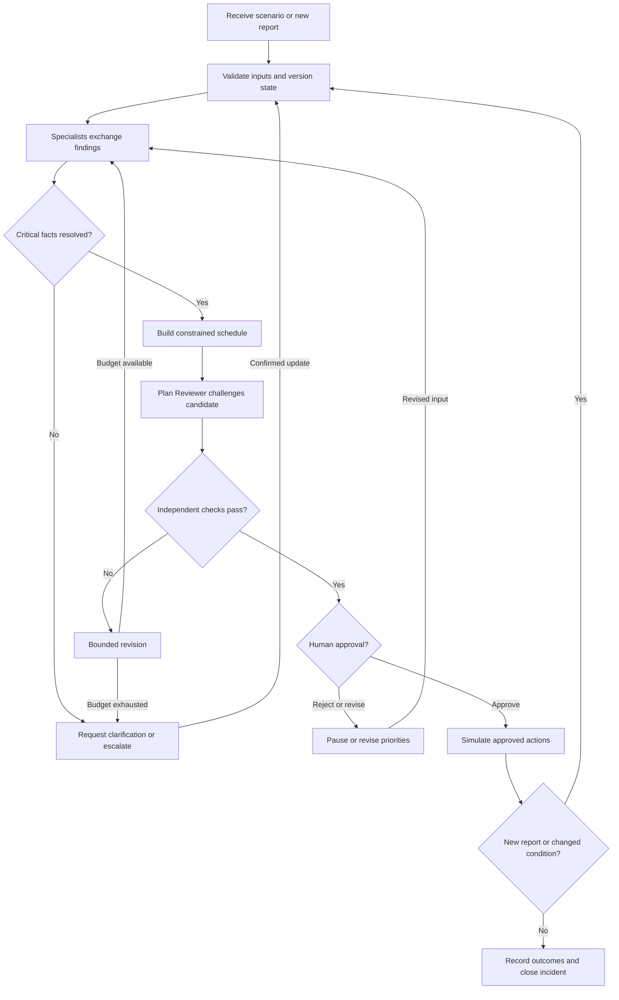

# RE:L!NK — Workflow

**Restore connectivity. Coordinate recovery.**

**Team:** HyperReAIlity, SLIIT
**Competition:** Innodata AI Catalyst 2026 - University Track
**Version:** 0.4 — matched hosted workflow, clarification and simulation
**Last updated:** 24 November 2026

This file describes the proposed process from the submitted [Proposal.docx](Proposal.docx). The planned agent design remains subject to hosted evaluation. Independent static/event simulation and the approval-gated continuation path are implemented; see handoffs/zahra.md for verified semantics and limits. See [PROJECT_DETAILS.md](PROJECT_DETAILS.md) for scope, technology choices, evaluation and disclosures.

## 1. Inputs and outputs

Inputs are a synthetic network graph, equipment/power state, service associations, incident reports, crews, generators, routes and operator-approved priorities. Records need stable identifiers, timestamps and explicit units. Initial scenarios cover 15–20 sites, two crews and limited backup power.

Outputs are a candidate schedule with assigned actions/resources, prerequisites, estimated start/end times, evidence IDs, validation results, unmet services, approval status and revision reasons. Approved actions execute only in the simulator.

## 2. Process flow



Clarification and rejection loops require a confirmed update or operator action; they must not spin automatically. Scenario completion includes explicit unmet services where resources are insufficient.

## 3. Stages and decisions

| Stage | Planned action | Result or decision |
| --- | --- | --- |
| 1. Receive and validate | Check schema, IDs, timestamps, units, graph references and required fields. | Accept valid records; show errors and request corrections for invalid inputs. |
| 2. Version shared state | Store observations and open questions; assign an incident/state version. | Material changes invalidate prior approval. Preserve provenance and earlier versions. |
| 3. Investigate dependencies | Network Investigator interprets reports and checks equipment, power and upstream prerequisites. | Evidence-linked faults, dependencies, contradictions and questions. |
| 4. Check field resources | Field Resource Planner checks skills, availability, travel, route access and generator autonomy. | Feasible actions, resource constraints and conflicts. |
| 5. Assess service priorities | Service Priority Assessor applies approved weights to affected service objects. | Prioritized service needs and explicit trade-offs. |
| 6. Resolve evidence gaps | Coordinator routes questions; compare with authoritative records or obtain operator confirmation. | Critical uncertainty blocks the affected action. Agent agreement alone cannot verify a fact. |
| 7. Schedule | Graph tools and CP-SAT create a candidate using the consolidated constraints. | A timed repair/power plan, or unmet tasks with reasons. |
| 8. Challenge and validate | Plan Reviewer challenges the candidate; separate software checks encoded feasibility. | Accept for human review, revise within budget, or escalate. |
| 9. Human decision | Display evidence, trade-offs, checks and unmet needs. Operator approves, rejects or changes priorities. | Approval is bound to the plan and current state version. |
| 10. Simulate | Verify current approval and apply actions to simulated state. | Progress, resource use and service outcomes. No real commands or crew dispatch. |
| 11. Replan or close | Process new reports, closures, resource loss or completion. | Revalidate and reapprove changed plans; record the final outcome and unresolved needs. |

## 4. Agent communication and state contract

The deterministic Python coordinator manages four specialist AI roles through a provider adapter. OpenAI is the initial hosted API provider; alternatives are tested on development cases. The primary benchmark uses the same model across all roles and the single-agent baseline.

Each message will include:

| Field | Meaning |
| --- | --- |
| `sender`, `recipient` | Originating and receiving role or coordinator |
| `incident_id`, `state_version` | Incident and exact state to which the finding applies |
| `finding` | Structured observation, constraint, question or challenge |
| `evidence_ids` | References to supporting input records |
| `requested_action` | Check, clarify, revise, acknowledge or escalate |

Shared state stores timestamped observations, verified facts, open contradictions, topology, resources, priorities, candidate plans, validation results and approval records. Messages for an obsolete state version must be rejected or explicitly re-evaluated. Agents have controlled state-write functions and read-only external-data tools.

### Illustrative collaboration

A draft assigns a generator to Site A. The Investigator finds A's backhaul is down. The Resource Planner finds the fibre-skilled crew cannot reach it because the access road is closed. The Priority Assessor identifies reachable Site B where power can restore a critical service. The Reviewer challenges the allocation to A. The coordinator requests confirmation, routes the findings back to the responsible roles and generates a revised plan prioritizing B while recording A's unmet repair.

Illustrative message, subject to the implemented schema:

```json
{
  "sender": "network_investigator",
  "recipient": "field_resource_planner",
  "incident_id": "demo-001",
  "state_version": 2,
  "finding": {
    "site_id": "A",
    "type": "backhaul_unavailable",
    "effect": "Power alone cannot restore the associated service."
  },
  "evidence_ids": ["report-A-02"],
  "requested_action": "Check a qualified crew and an accessible repair route."
}
```

This example is synthetic; evidence IDs establish traceability, while verification still requires consistency checks and authoritative confirmation.

## 5. Scheduling and simulation rules

The primary objective is minimum weighted service downtime over 12 hours, with travel and unnecessary reassignment as secondary tie-breakers. Approved weights belong to service objects, which avoid overlapping-site double counts.

Supported actions must respect repair prerequisites, durations, crew skills, travel/access and no overlapping allocation of crews or generators. A restored service requires working equipment, adequate power and a valid path to the core. Generator power expires at its configured autonomy; fuel replenishment is excluded.

The independent validator rechecks the schedule against the scenario constraints, separately from agent claims and solver status. It checks references, timing, dependencies, resources, power duration and access. Never label a timed-out solver result optimal without a valid proof/bound. No accepted plan may silently relax constraints.

## 6. Revision, failure handling and approval

- At most three revision rounds and one schema-repair retry per model response.
- Global automated-run caps: 12 calls, 24,000 input tokens, 4,800 output tokens and 180 seconds, including retries and reported reasoning usage where applicable. Stop at the first cap.
- Each scheduler attempt is limited to five seconds. Record feasible/infeasible/timeout status and any available bound.
- Transient API failures and rate limits use bounded retries/backoff within the same global budgets. Unavailable service, quota exhaustion or exhausted budgets cause escalation, not silent model substitution.
- Missing critical facts pause affected actions. Resource shortages produce explicit unmet tasks and reasons.
- A changed state invalidates approval. Human rejection pauses simulation; changed priorities require a reviewed candidate and fresh approval.
- Preserve in-progress simulated work when it remains feasible; explain any interruption or reassignment.

## 7. Traces and evidence

JSONL traces will record incident/state version, agent messages, evidence links, tool invocations, candidate/revision IDs, validation outcomes, provider/model identifiers, tokens and request IDs where available, latency, retries, API cost, approvals and simulated outcomes. Use dated provider rates for estimated costs and distinguish estimates from billed charges or credits.

Keep API keys backend-only. Commit only synthetic/redacted samples and authorized evidence. Reports are untrusted input and cannot modify system instructions, permissions or service priorities. Confidential organizer materials must not be sent to unauthorized external services.

## 8. Evaluation workflow

1. Create 10 development cases and 20 held-out cases; independently audit labels and constraints.
2. Include two held-out cases per category: equipment-only fault; power-only fault; coupled power/backhaul loss; skill shortage; route closure; conflicting reports; stale reports; missing critical evidence; generator exhaustion; mid-incident resource loss requiring replanning.
3. Test candidate models only on development cases. Freeze model IDs, settings, prompts, budgets, seeds and held-out fixtures before evaluation.
4. Run the heuristic, conventional optimizer, comparable single agent, full multi-agent workflow and separate reviewer/feedback ablations. Repeat AI configurations three times per scenario and interleave matched comparisons.
5. Run the exploratory human comparison: target four consenting participants and six shared small cases, with disclosed expertise, counterbalanced order and up to ten minutes per case using manual schedule entry.
6. Score with the same independent checker and simulator. Record valid plans, correct escalations, invalid outputs, timeouts and unmet services; failed/invalid plans receive no additional restoration credit.
7. Use scenario medians across repeats, paired differences and exploratory scenario-level bootstrap intervals. Separate automated planning, human approval and simulated restoration time. Publish failures and negative results.

The proposed success targets and full metric definitions are in [PROJECT_DETAILS.md](PROJECT_DETAILS.md). No execution or benchmark result is asserted by this workflow.

## 9. Implementation and documentation milestones

| November 2026 | Planned milestone |
| --- | --- |
| 20 | Proposal, shared schemas, API feasibility and priority baseline |
| 21–22 | Simulator, independent validator, CP-SAT and single-agent workflow |
| 23–24 | Four-agent exchanges, versioning, traces and dashboard |
| 25 | Event-driven replanning and approval expiry; feature/configuration freeze |
| 26 | Held-out evaluation, ablations and human comparison |
| 27 | Defect fixes, evidence, documentation, actual-execution video and clean-install check |
| 28, 6:00 PM | Internal MVP and complete project plan upload; verify paths and reviewer access |
| 29, 11:59 PM | Official Phase 1 deadline; contingency verification |

All times are Sri Lanka time. Before final submission, reconcile this workflow with implemented behavior, replace illustrative schemas with actual contracts and link representative traces and a reproducible execution guide.


## Implemented incident continuation

A simulation advances only to the next unrevealed incident event or horizon.
At a crew-loss event it records completed work, pauses affected unfinished work
without partial repair credit, cancels later departures and retains unaffected
already-started work under its original approval. The operator accepts a visible
checkpoint, generates a revised plan and approves a higher state version before
resuming. The private episode retains equipment/link state, fuel timers, crew
reservations and all elapsed service intervals. Full-horizon metrics are null for
partial episodes; final metrics cover the original 720-minute timeline exactly
once. Expected generator expiry is part of the visible continuation contract;
private future incident events are never passed to agents. Checkpoints are local
session state; history is read-only and cannot restore authorization.

## Implemented clarification checkpoint

Planning now provides an explicit operator confirmation form. Recording evidence preserves the source reports, versions the state, clears prior plan/approval and requires a separately reviewed replacement plan. Corrections and confirmation history are auditable. See [OPERATOR_CONFIRMATION.md](OPERATOR_CONFIRMATION.md) for supported facts, continuation semantics and verification limits.

## Matched hosted workflow checkpoint

Both hosted modes now traverse investigation, resource assessment, priority assessment and review. Single mode retains one agent identity; multi mode uses four role contexts. Operational context, deterministic tools and whole-incident caps match. Evidence-linked deferral requests change the next validated candidate, retain unmet needs and appear before human approval. Benchmark configuration and usage are recorded, and paired summaries report exclusions/failures alongside measured downtime. See [HOSTED_FAIRNESS.md](HOSTED_FAIRNESS.md). Live provider verification awaits the exact model ID.
